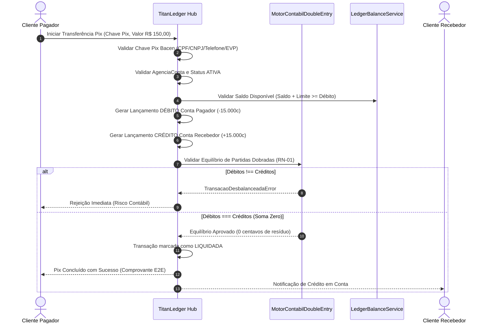

# 🏛️ TitanLedger & Clearing Hub
> **Módulo:** `titan-ledger-hub`  
> **Segmento:** Core Banking, Instituições de Pagamento (IP), Liquidação Instantânea Pix (SPI/Bacen) & Double-Entry Bookkeeping  
> **Arquitetura:** Domain-Driven Design (DDD), Clean Architecture, Append-Only Immutable Ledger, Unit of Work ACID, Mutex Locks & Finite State Machines  
> **Autor:** Guilherme Santiago Floriano (Tech Lead / Senior Software Engineer)

---

## 1. O Problema Real de Negócio (Business Problem)

Em sistemas de Core Banking, processamento de transferências instantâneas (Pix) e liquidação interbancária perante o Banco Central do Brasil (Bacen), arquiteturas simplórias que utilizam colunas mutáveis de `saldo` e operações `UPDATE conta SET saldo = saldo - 100` enfrentam graves vulnerabilidades sistêmicas:

1. **Assimetria Contábil e Vazamento Financeiro (*Money Leak*):**  
   Quando o débito da conta do pagador é efetivado e o crédito do recebedor falha no meio do processamento distribuído, dinheiro desaparece ou é criado indevidamente sem contrapartida.
2. **Perda de Rastreabilidade e Auditoria Fiscal:**  
   Em saldos mutáveis, é impossível reconstituir com precisão cirúrgica a trajetória de cada centavo em uma auditoria do Bacen ou disputa judicial de conciliação.
3. **Erros e Fraudes em Chaves Pix:**  
   A ausência de validação algorítmica estrita nos formatos oficiais do Bacen (CPF/CNPJ com duplo dígito verificador, telefone E.164, e-mail RFC e EVP UUIDv4) resulta em rejeições massivas no SPI ou envio irreversível para destinatários incorretos.

---

## 2. A Solução: Partidas Dobradas (*Double-Entry Bookkeeping*) & Append-Only Ledger

O **TitanLedger & Clearing Hub** foi concebido sob princípios estritos de Clean Architecture e DDD corporativo:

- **Invariante Fundamental de Partidas Dobradas (RN-01):**  
  Toda movimentação financeira gera no mínimo 2 lançamentos contábeis complementares: um DÉBITO e um CRÉDITO de igual valor.
  $$\sum \text{Débitos} = \sum \text{Créditos} \implies \text{Saldo da Transação} \equiv 0\text{ centavos}$$
- **Imutabilidade Absoluta (Append-Only):**  
  Lançamentos contábeis (`LancamentoContabil`) são estritamente imutáveis. Não existem `UPDATE` nem `DELETE`. Correções, cancelamentos e devoluções Pix ocorrem exclusivamente através de **estornos contábeis reversos** auditáveis.
- **Value Objects Imutáveis com Validação em Fábrica:**
  - `ChavePix`: Validação estrita dos 4 tipos de chaves DICT do Bacen (CPF/CNPJ com mod-11, Telefone E.164 `+55...`, E-mail RFC 5322 e EVP UUIDv4 canônico de 36 caracteres).
  - `ValorMonetario`: Modelado exclusivamente em **centavos inteiros (Integer Cents)**, eliminando 100% de desvios de ponto flutuante (*Zero Float Drift*).
  - `AgenciaConta`: Validação de código COMPE (3 dígitos), agência (4 dígitos) e conta-dígito padrão Febraban.
- **Aggregate Roots & Entidades com FSM:**
  - `ContaContabil`: Representação do plano de contas (Ativo, Passivo, Patrimônio, Despesas, Receitas) com estados `ATIVA`, `BLOQUEADA_JUDICIAL`, `SUSPENSA` e `ENCERRADA`.
  - `TransacaoDeTransferencia`: Aggregate Root que orquestra as partidas dobradas com ciclo controlado `CRIADA` -> `PROCESSANDO` -> `LIQUIDADA` (ou `FALHADA` / `ESTORNADA`).
- **Serviços de Domínio Críticos:**
  - `MotorContabilDoubleEntry`: Validador matemático que rejeita qualquer transação com 1 centavo de assimetria via `TransacaoDesbalanceadaError`.
  - `LedgerBalanceService`: Motor de apuração de saldo a partir do histórico imutável e fiscal de limite de cheque especial (`RN-04`).

---

## 3. Diagramas de Arquitetura

### 3.1. Fluxo de Transferência Pix com Partidas Dobradas



---

## 4. Regras Negociais Invariantes (Release Gates)

| Código | Invariante Negocial | Validação Técnica |
| :--- | :--- | :--- |
| **RN-01** | **Equilíbrio Rigoroso de Partidas Dobradas** | Toda transação financeira possui $\sum \text{Débitos} = \sum \text{Créditos}$. Divergência de 1 centavo lança `TransacaoDesbalanceadaError`. |
| **RN-02** | **Imutabilidade e Append-Only Ledger** | Lançamentos contábeis são imutáveis e permanentes. Estornos operam via novos lançamentos contrapostos auditáveis. |
| **RN-03** | **Validação Estrita de Chaves Pix Bacen** | Chaves Pix validadas pelos 4 padrões oficiais do Bacen (CPF/CNPJ mod-11, E-mail RFC, Telefone E.164, EVP UUIDv4). |
| **RN-04** | **Zero Descoberto sem Limite Aprovado** | Nenhuma conta corrente de cliente pode ficar com saldo negativo se o limite for zero. Violação lança `SaldoInsuficienteError`. |
| **RN-05** | **Integridade da FSM da Transação** | Transições de estado controladas (`CRIADA` ➔ `PROCESSANDO` ➔ `LIQUIDADA` ➔ `ESTORNADA`). Transições arbitrárias disparam exceções tipadas. |
| **RN-06** | **Atomicidade ACID & Rollback Transacional** | Falhas durante liquidação revertem integralmente lançamentos via `UnitOfWork` sem poluir o ledger (*All-or-Nothing*). |
| **RN-07** | **Idempotência Estrita de Mensageria/SPI** | Replays com mesma `idempotencyKey` retornam a transação idêntica instantaneamente sem duplicar lançamentos. |
| **RN-08** | **Serialização Concorrente & Prevenção de Deadlock** | Concorrência gerida por mutex locks ordenados lexicograficamente, blindando contra double-spending e deadlocks. |

---

## 5. Arquitetura de Persistência ACID & Concorrência (Fase 2)

- **`IUnitOfWork` / `InMemoryUnitOfWork`**: Gerencia contextos transacionais isolados com snapshot de repositórios. Qualquer falha no pipeline contábil desfaz adições ao ledger de forma estrita.
- **`AsyncMutexLockManager`**: Implementa semáforos exclusivos por recurso (`[contaOrigemId, contaDestinoId]`) ordenados alfabeticamente para eliminar deadlocks em transferências cruzadas simultâneas.
- **`ProcessarTransferenciaPixUseCase`**: Orquestra idempotência, locks, validação de saldo no ledger, cálculo de partidas dobradas e liquidação atômica.
- **`EstornarTransferenciaPixUseCase`**: Executa contrapartidas contábeis reversas completas mantendo o histórico de auditoria imutável (Append-Only).

---

## 6. Como Executar os Testes Automatizados

O projeto utiliza o executor nativo do Node.js (`node:test` e `node:assert/strict`), sem dependências externas de teste:

```bash
# Instalar dependências de tipagem TypeScript
npm install

# Compilar TypeScript
npm run build

# Executar bateria de testes automatizados de domínio e persistência ACID
npm test
```

### Resultados da Suíte de Testes (25/25 Pass - 100%):
- `🏛️ Suíte de Aplicação & Persistência ACID (Fase 2)`: **7 testes aprovados**
  - Execução atômica e liquidação com partidas dobradas
  - Idempotência estrita e replay idempotente
  - Rollback atômico contra saldo insuficiente
  - Concorrência severa (prevenção de double-spending)
  - Prevenção de deadlocks em transferências cruzadas simultâneas
  - Rejeição de chave Pix inexistente
  - Estorno contábil atômico e restauração de saldos
- `🏛️ Suíte de Domínio (Fase 1)`: **18 testes aprovados**
  - `AC-F1-01: Validação Estrita dos 4 Tipos de ChavePix (RN-03)`: 5 testes aprovados
  - `AC-F1-02: Motor de Partidas Dobradas com Soma Zero (RN-01)`: 3 testes aprovados
  - `AC-F1-03: Imutabilidade Contábil e Cálculo de Saldo (RN-02)`: 2 testes aprovados
  - `AC-F1-04: Proteção contra Saldo Negativo e FSM da Conta (RN-04)`: 4 testes aprovados
  - `AC-F1-05: Ciclo Completo de Transferência Pix com Liquidação e Estorno (RN-05)`: 2 testes aprovados
  - `Value Objects Auxiliares: ValorMonetario e AgenciaConta`: 2 testes aprovados
